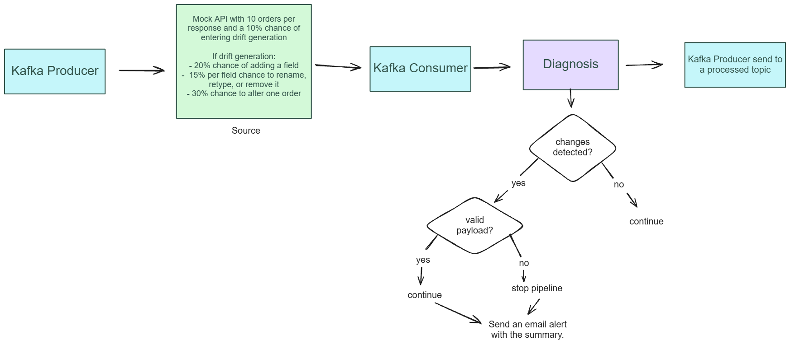

# SchemaDiagnoser use example

This example sends mock orders through Kafka, checks them against a data
contract, and uses Jev to review detected schema changes. Accepted orders can
be adapted and published; detected changes also trigger an email alert.

## Workflow

## Estimated cost

The mock API returns 10 orders per response. By default it enables drift
generation for 10% of responses; this is not a 10% chance that every order
actually has drift. For each enabled response, it has a 20% chance of adding a
field, a 15% chance of changing each field's name or type or omitting it,
and a 30% chance of changing one individual order. Orders in a response share
the generated schema apart from that possible individual change.

For an illustrative run of **100,000 orders** (10,000 responses), the default
probabilities imply approximately:

| Outcome | Expected responses |
| --- | ---: |
| Drift generation enabled | 1,000 |
| A shared schema change | 815 |
| No shared change, but an individual order changed | 56 |
| A shared change and an individual order changed | 244 of the 815 above |

The shared-change estimate is `1,000 × (1 - 0.8 × 0.85^9)`: it assumes
the nine original fields are unchanged only when none is selected for variation
and no extra field is added. The individual-change counts use the additional
30% probability. Actual detected changes can differ when an individual change
overlaps or reverses a shared change.

For 100,000 orders, the estimated Jev cost is **$0.019–$0.047**. This estimate
assumes about 1,115 fresh reviews: one for each of the 815 responses with shared
drift, plus one for each of the 300 individual changes. At 400–1,000 input
tokens per review, that is roughly 446,000–1,115,000 tokens, priced at
[$0.042 per million input tokens](https://docs.typesafe.ai/models). The token
count is a planning assumption, not a measurement.

This is a scenario rather than a predicted bill. Successful equivalent reviews
are cached for five minutes per process, so the other orders sharing a schema
can reuse a review and repeated patterns across responses may reduce requests
further. Different changes, cache expiry or eviction, multiple consumer
processes, and failed reviews can increase requests. The price covers Jev input
charges only; check `review["input_tokens"]` on successful fresh reviews for
actual usage. The producer currently accesses `order['order_id']` even though
drift can rename or omit that field, so a run may stop before 100,000 orders.
